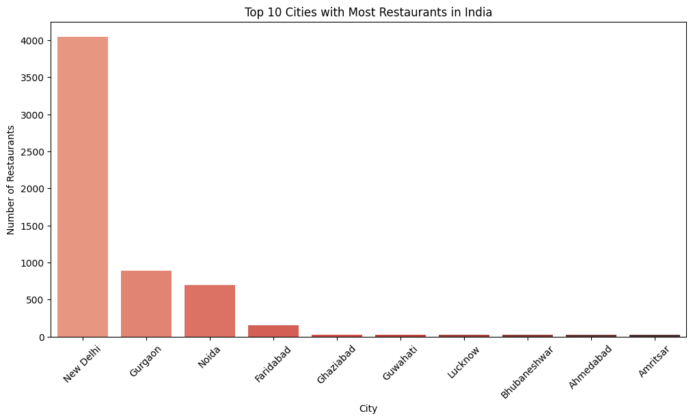
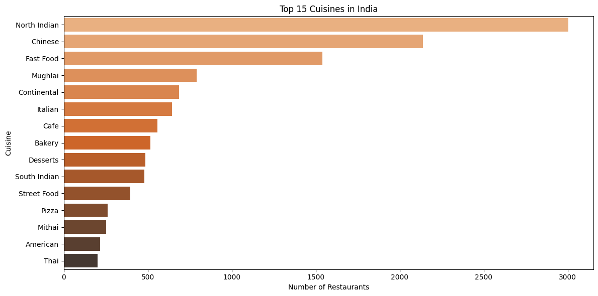
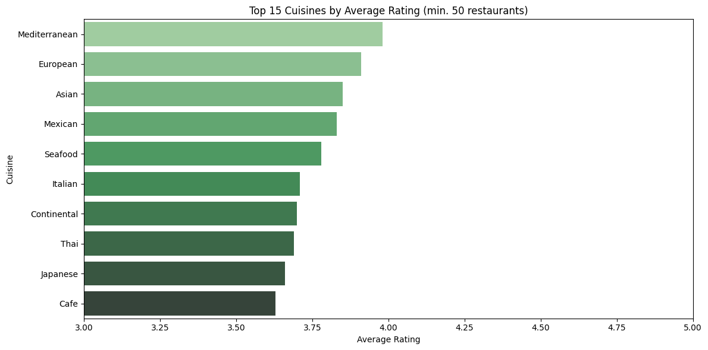
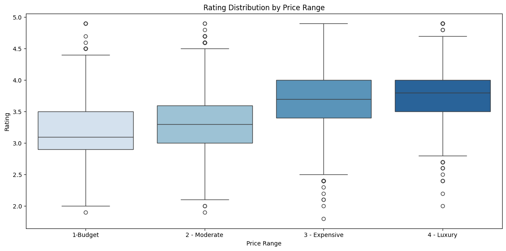
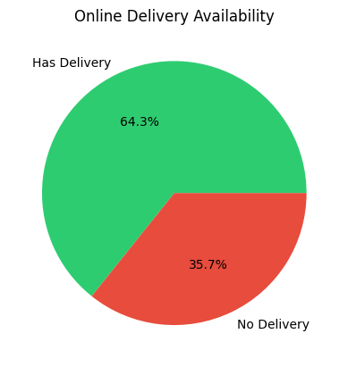
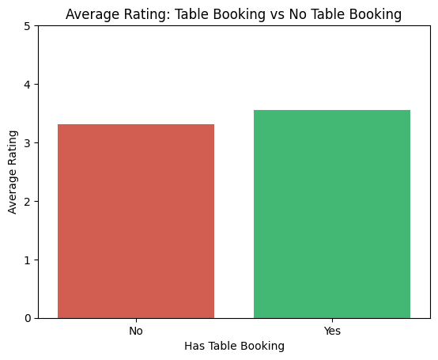
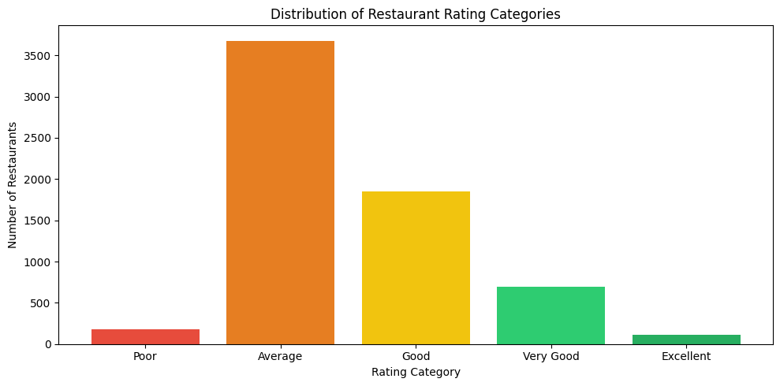
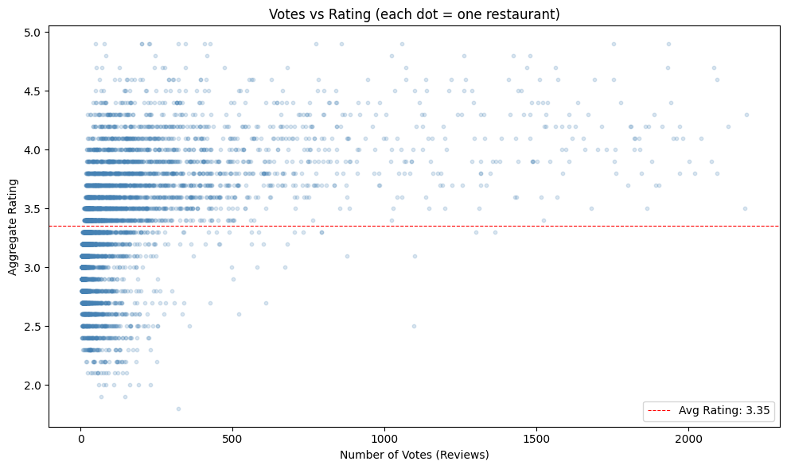

# 🍽️ Zomato India Restaurant Analysis


> Exploratory data analysis of 6,500+ restaurants listed on Zomato India — uncovering cuisine trends, rating patterns, delivery adoption, and what actually makes a restaurant successful.

---

## 🔍 Business Problem

Zomato operates in a highly competitive food-tech market. This analysis answers questions a product or business analyst at Zomato would actually be asked:

1. Where is Zomato's restaurant coverage strongest — and where are the gaps?
2. Which cuisines are most popular, and which ones are rated highest?
3. Does price, table booking, or online delivery affect customer ratings?
4. What does the overall quality landscape of Indian restaurants look like?

---

## 📊 Key Findings

- **New Delhi dominates the platform** with 4,048 restaurants — 62% of all rated India listings. Every other city has fewer than 900 listings, showing a major coverage gap outside NCR
- **North Indian (3,003), Chinese (2,139), and Fast Food (1,540) are the top 3 cuisines by supply** — but Mediterranean (3.98) and European (3.91) restaurants rate significantly higher despite fewer listings
- **Only 35.7% of restaurants offer online delivery** — meaning nearly two-thirds of Zomato's India partners are dine-in only, a large untapped opportunity for delivery growth
- **Restaurants with table booking rate 0.24 points higher on average** (3.55 vs 3.31) — suggesting higher-quality restaurants are more likely to adopt the feature
- **Most restaurants are rated Average (3,678 out of 6,513)** — only 116 restaurants (1.8%) are rated Excellent, indicating the platform's quality ceiling is rarely reached
- **Overall average rating is 3.35 out of 5** — below global benchmarks, suggesting Indian users rate more strictly

---

## 🖼️ Visualizations

### Restaurants by City


### Top 15 Cuisines by Count


### Top 15 Cuisines by Avg Rating


### Price Range vs Rating


### Online Delivery Share


### Table Booking vs Rating


### Rating Distribution


### Votes vs Rating


---

## 🛠️ Tech Stack

| Tool | Purpose |
|------|---------|
| Python (pandas) | Data loading, filtering, groupby analysis |
| Python (matplotlib, seaborn) | 9 visualizations |
| Jupyter Notebook | Analysis environment |

---

## 📁 Project Structure

```
zomato-restaurant-analysis/
│
├── data/
│   └── zomato.csv                   # Zomato India dataset (9,551 rows, 21 columns)
│
├── notebooks/
│   └── zomato_analysis.ipynb        # All 8 analyses in one notebook
│
├── visuals/
│   ├── restaurants_by_city.png
│   ├── top_cuisines.png
│   ├── cuisine_avg_ratings.png
│   ├── price_vs_rating.png
│   ├── online_delivery_share.png
│   ├── table_booking_vs_rating.png
│   ├── rating_distribution.png
│   └── votes_vs_rating.png
│
└── README.md
```

---

## ⚙️ Setup & Run

### 1. Clone the repo
```bash
git clone https://github.com/pushkesh-m/zomato-restaurant-analysis.git
cd zomato-restaurant-analysis
```

### 2. Install dependencies
```bash
pip install pandas matplotlib seaborn jupyter
```

### 3. Run the notebook
```bash
jupyter notebook
```
Open `notebooks/zomato_analysis.ipynb` and run all cells.

> **Note:** The CSV must be loaded with `encoding='latin-1'`. Using `utf-8` will throw a UnicodeDecodeError on this file.

---

## 📂 Dataset

**Source:** Zomato Restaurants Data by Shruti Mehta
- **Raw rows:** 9,551 (global)
- **After India filter (Country Code == 1):** 8,652
- **After removing unrated restaurants:** 6,513 usable rows
- **Columns:** 21 (Restaurant Name, City, Cuisines, Price range, Aggregate rating, Votes, Has Online delivery, Has Table booking, etc.)
- Available on [Kaggle](https://www.kaggle.com/datasets/shrutimehta/zomato-restaurants-data)

---

## 💡 Business Recommendations

1. **Expand coverage beyond NCR** — Delhi, Gurgaon, and Noida make up 87% of the data. Mumbai, Bengaluru, Hyderabad, and Pune represent a large untapped market for restaurant onboarding
2. **Prioritise converting dine-in restaurants to delivery** — 64.3% of restaurants have no delivery option despite delivery being Zomato's core revenue product
3. **Promote Mediterranean, European, and Asian cuisine restaurants** — these cuisines average 3.78 to 3.98 ratings and are underrepresented relative to demand; featuring them can lift perceived platform quality
4. **Use table booking adoption as a quality signal** — restaurants with table booking average 0.24 points higher in ratings; Zomato can use this as a tier indicator for premium placement

---

## 📬 Connect

**GitHub:** [pushkesh-m](https://github.com/pushkesh-m)

---

*This project was built as part of a data analytics portfolio. Dataset is publicly available on Kaggle.*
